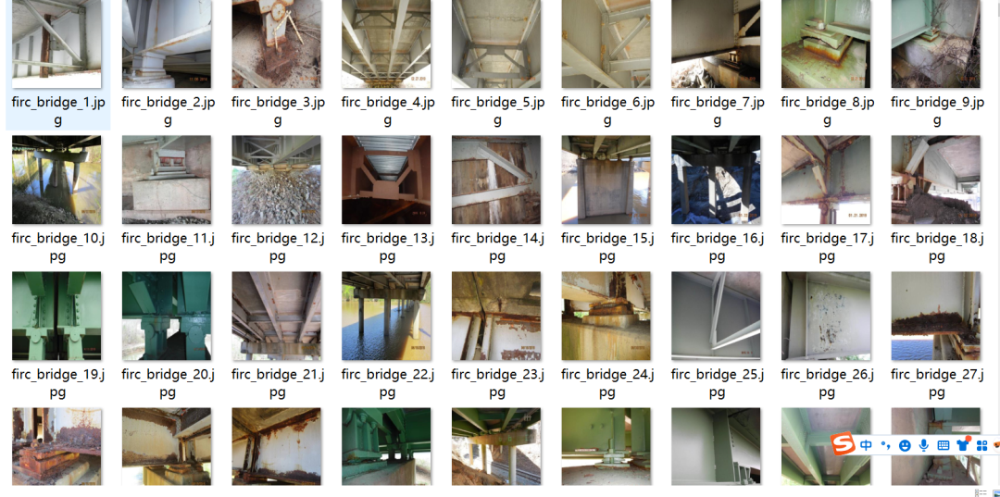
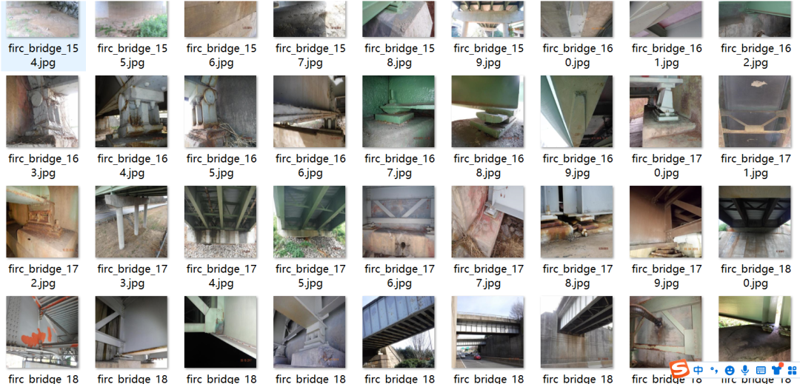
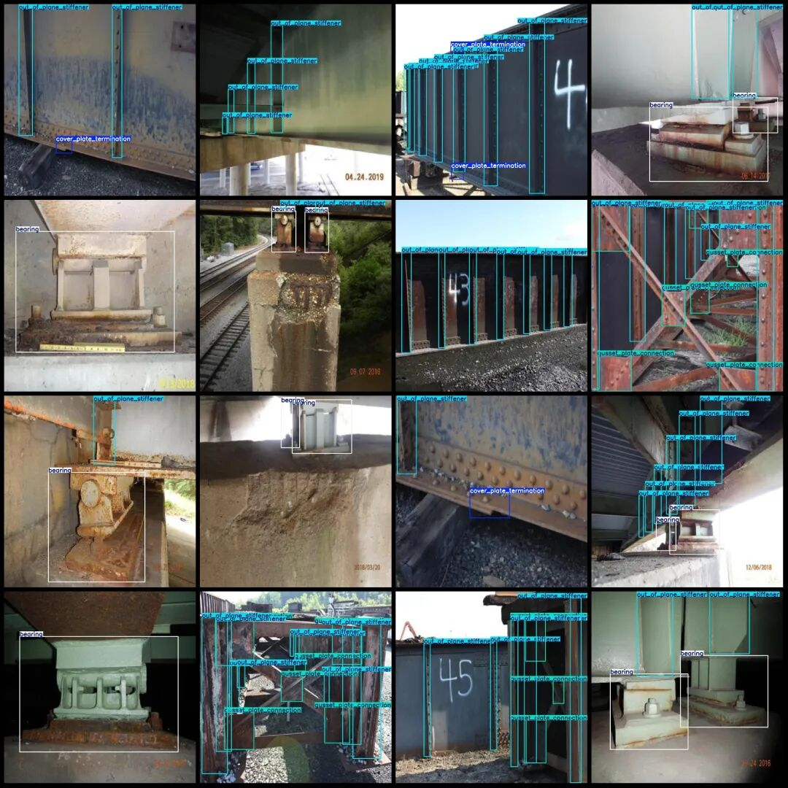
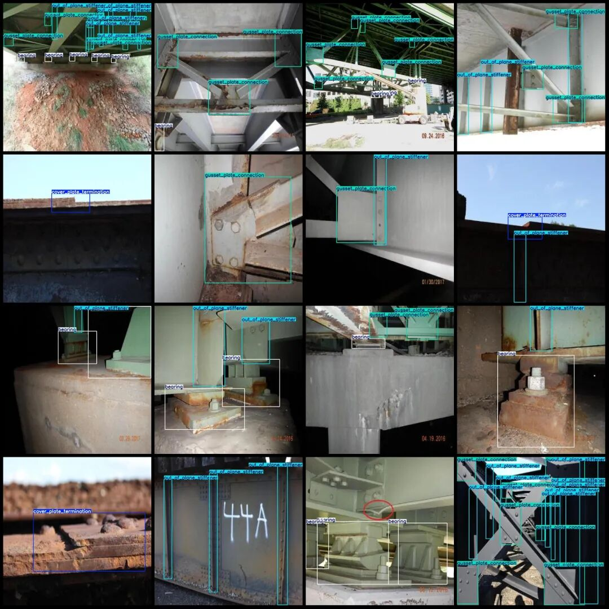

# Bridge Structure Parts and Node Detection Dataset VOC+YOLO format with 1455 images in 4 categories

Dataset format: Pascal VOC format + YOLO format (txt file without split path, only containing jpg images and corresponding VOC format xml files and yolo format txt files)

Number of images (number of jpg files): 1455

Number of annotations (number of xml files): 1455

Number of annotations (number of txt files): 1455

Labeling category count: 4

Label category names (note that the order of categories in the YOLO format does not correspond to this, but is based on the labels folder's classes.txt): ["bearing", "cover_plate_termination", "gusset_plate_connection", "out_of_plane_stiffener"]

Number of boxes labeled in each category:

Bearing (bearing/bearing seat) Frame Count = 1820

Cover Plate Termination (Cover Plate End) Frame Count = 302

gusset_plate_connection (node plate connection) frame count = 992

Out-of-plane stiffener (Plane extra stiffener) frame count = 3559

Total frame count: 6673

Image resolution: 1280x1280

Using labelImg:

Annotation rules: Draw a rectangle around the category.

Important Notice: The dataset does not have separate training, validation, and test sets; you need to partition them yourself.

Special : This dataset does not guarantee the accuracy of the trained models or weight files.

Image Preview:

Annotation example:

## Payment

Here is a pay link on Stripe ( https://buy.stripe.com/3cs8yP7sY87d0vu9AB ). Please contact me lonlonago@foxmail.com after funding $89, and I will send you a complete data files , thank you!

